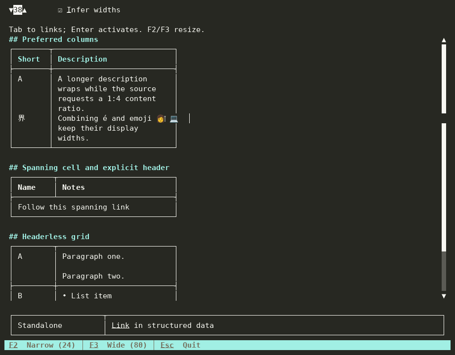

# Markdown tables

`Markdown` renders pipe and grid tables with the same layout used for drawing,
links, selection, and ANSI output. Grid cells can contain paragraphs, explicit
line breaks, lists, and code. The parser determines which rows are headers;
headerless grids receive no synthetic header. Column and row spans suppress
internal borders and retain the originating cell's content once.

## Preferred column widths

To infer pipe-table proportions from separator dash counts, supply a pipeline:

```csharp
using Markdig;
using Markdig.Extensions.Tables;
using Terminal.Gui.Views;

Markdown preview = new ()
{
    MarkdownPipeline = new MarkdownPipelineBuilder ()
        .UsePipeTables (new PipeTableOptions { InferColumnWidthsFromSeparator = true })
        .UseAdvancedExtensions ()
        .Build (),
    Text = "| Short | Description |\n| ----- | -------------------- |\n| A | B |"
};
```

Register configured pipe tables before `UseAdvancedExtensions`; an existing
extension registration is retained. The default pipeline remains unchanged.
Markdig supplies grid-table proportions directly from source column widths.

Widths describe **content space**. Each column also has one space of padding on
each side, and each border track occupies one terminal cell. For `n` columns,
the allocated tracks require `sum(content widths) + 3*n + 1` cells. A cell spanning `k`
columns reclaims `3*(k - 1)` cells of intermediate padding and separators.

Without positive preferences, ordinary tables retain content-driven sizing:
use natural widths when they fit, collapse wider columns toward their longest
words, then split long words if necessary. Left columns win ties. The outer right
border still reaches the view edge for compatibility. Any trailing space between
the final cell's allocated track and that border belongs to no cell or link;
alignment uses the allocated track, not the outer border.

With preferences:

1. Normalize fully specified percentages to a total of 100.
2. For partial preferences totaling less than 100, distribute the remaining
   percentage among automatic columns in proportion to natural content widths.
3. For partial preferences totaling at least 100, reserve automatic columns'
   preferred minima, then divide the remainder among specified columns in their
   requested ratio. Use hard minima if preferred minima cannot fit.
4. Enforce longest-word minima when feasible. Otherwise permit word splitting,
   retaining enough space for complete graphemes. Redistribute space after
   pinning columns to their minima.
5. Round down and award remaining cells in descending fractional-remainder
   order, with ties resolved from left to right.

For example, a width of 47 leaves 40 content cells for two columns after seven
padding/border cells. A 20:80 preference yields content widths 8 and 32, or
padded column widths 10 and 34. Width 46 yields content widths 8 and 31.
Preferences can expand content beyond natural width; they are not hard limits.
Zero and null mean automatic. Negative and nonfinite public preferences are
rejected.

Spanning-cell bounds are interval constraints. The allocator processes shorter
spans first, then row/column order, and distributes deficits evenly over covered
tracks, awarding leftovers left to right. Row-span height deficits use the same
rule from top to bottom. Spanning cells can use suppressed row-border space.

## Narrow terminals and resizing

Below the minimum needed for intact graphemes, padding, and borders, tables
retain their logical width and overflow horizontally. To see clipped columns,
scroll horizontally. No content is removed from layout to fit the viewport.
Resizing recomputes wrapping, row heights, borders, and link geometry from cached
intrinsic measurements. Table overflow does not become the next pass's width
constraint. Explicit document content widths remain supported.

CJK and emoji can require two content cells. Combining sequences and ZWJ emoji
stay together. A grapheme split across style segments uses the base segment's
attributes and link ownership for its indivisible display cluster. Selection
that touches either occupied cell of a wide grapheme copies the whole grapheme
once.

Code cells retain whitespace and blank lines; long lines wrap at grapheme
boundaries. Paragraphs have a blank line between them. Lists retain markers,
indentation, and continuation alignment. Nested tables and raster images do not
create interactive views within cells; nested structures use a text fallback,
and images use their existing alt-text fallback. Cell headings do not register
document heading anchors.

`RenderToAnsi` draws through the existing headless driver at the requested width.
It matches the visible viewport, including horizontal clipping, rather than
exporting a different, wider layout.

## Standalone data

To retain existing inline-source behavior, use the original constructor:

```csharp
TableData simple = new (["Name", "Notes"], [Alignment.Start, Alignment.Start],
                        [["**Markdig**", "[Website](https://github.com/xoofx/markdig)"]]);
MarkdownTable table = new () { TableData = simple, Width = 60 };
```

To define a rich grid, use library-owned column, row, and cell descriptions:

```csharp
TableData grid = TableData.CreateGrid (
    [new (preferredWidthPercentage: 20), new (preferredWidthPercentage: 80)],
    [new (true, [new (0, "Name"), new (1, "Notes")]),
     new (false, [new (0, "A spanning **paragraph**\n\n- first\n- second", columnSpan: 2)])]);
MarkdownTable table = new () { TableData = grid, Width = 60 };
```

Structured cell strings contain **block** Markdown. Legacy constructor strings
remain **inline** Markdown: a leading list marker or heading marker stays literal.
Columns and rows are snapshotted, and their descriptions are immutable. Spans
must be positive, remain within the supplied rows/columns, and not overlap.
Positions not supplied explicitly render as empty cells. Include logical rows
occupied entirely by row spans in the supplied row collection.

`TableData.Columns` and `TableData.TableRows` expose the complete representation.
For structured data, the legacy arrays are lossy projections: `Headers` contains
the first explicit header row, or is empty; `Rows` contains every other logical
row, including additional headers. An originating cell's source occupies its
starting slot; covered slots are empty. `ColumnCount` describes the logical grid.

Legacy arrays remain mutable. To refresh a table after editing these arrays,
reassign `MarkdownTable.TableData`. `CalculateTableHeight` remains a single-line
estimate; actual height comes from layout. The standalone `Text` setter continues
to accept pipe syntax. Rich `Text` output uses the clipboard representation below
and is not promised to round-trip through that setter.

## Selection and copying

- Whole-document selection returns the original document source.
- Complete ordinary tables inside a larger selection use safe pipe-table source,
  retaining original inferred separator proportions where available.
- Complete parsed grid tables return their original table block source, including
  spans and block content. Enclosing quote markers and list indentation are
  removed so the copied table can stand alone. External reference definitions
  remain external.
- Partial table selections return visible text in display-row order. Borders are
  omitted; intervening alignment/padding spaces and selected line breaks remain;
  trailing layout padding is trimmed. A partial selection no longer expands to
  the entire table. Spans do not duplicate their originating content.
- Rich standalone data without original table source uses tab-separated logical
  rows in cell-origin order, with empty covered slots. Multiline fields are
  quoted and embedded quotes doubled. This is a delimited-text fallback, not
  lossless Markdown serialization.

To explore these behaviors, run the **Markdown Tables** UICatalog scenario.
Use F2/F3 for narrow/wide content constraints, toggle inferred pipe widths, and
Tab to links. The scenario reports activated URLs without opening a browser.


## Recordings

The recordings exercise narrow → wide → narrow content widths and activate the
original URL in a spanning cell. The casts retain the terminal output for inspection.



[100-column cast](../images/views/MarkdownTables100.cast) ·
[40-column recording](../images/views/MarkdownTables40.gif) ·
[40-column cast](../images/views/MarkdownTables40.cast)

To reproduce the recordings, build `Examples/ScenarioRunner`, then use the
[tuirec guide](https://github.com/tui-cs/Terminal.Gui/blob/develop/Scripts/tuirec/README.md).
Run this command at both `--cols 40` and `--cols 100`, changing the output name:

```bash
tuirec record --binary dotnet \
  --args 'Examples/ScenarioRunner/bin/Debug/net10.0/ScenarioRunner.dll,run,Markdown Tables' \
  --cols 100 --rows 35 --name MarkdownTables100 \
  --keystrokes 'wait:1500,F2,wait:800,F3,wait:800,F2,wait:800,Tab,Tab,Tab,Enter,wait:1000,Esc' \
  --startup-delay 1500 --drain 1000 --max-duration 35
```
